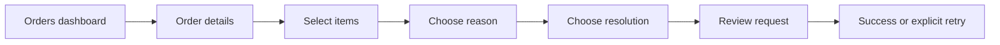
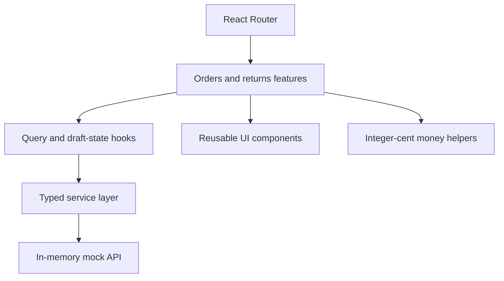

# Solvpath post-purchase experience

A React and TypeScript take-home project that models the customer journey after checkout: find an order, inspect its details, and complete a guided return or exchange. The application uses an in-memory service layer so the UI states and business rules can be reviewed without a backend.

## Product walkthrough

The orders dashboard supports status filtering, text search and pagination. Delivered orders lead into a four-step return flow:

1. Select eligible items and quantities.
2. Choose a return reason and add optional context.
3. Select a refund, exchange or store-credit resolution.
4. Review the request before submitting it.

Quantities cannot exceed the original order, non-returnable items remain disabled, and store credit includes the configured 10% bonus. Reads may retry transient failures; return submissions require an explicit retry to avoid silently duplicating a write.



## Architecture



- `src/features/orders` contains the dashboard, filters, cards and order details.
- `src/features/returns` contains the guided flow and its step components.
- `src/hooks` owns server-state queries and the return-draft reducer.
- `src/services` provides the network boundary and mock implementation.
- `src/lib/money.ts` keeps price calculations in integer cents.
- `src/components` contains shared loading, error, form and status primitives.

TanStack Query manages asynchronous reads and writes. React Router keeps order details addressable, while the return flow is loaded lazily. Loading, empty and failure states are represented explicitly instead of being folded into the happy path.

## Run locally

Prerequisites: a current Node.js release and npm.

```bash
npm install
npm run dev
```

Open `http://localhost:5173`.

Useful project commands:

```bash
npm run typecheck
npm run lint
npm run test
npm run build
```

The commands are documented from the repository configuration; this portfolio review did not install dependencies or execute them.

## Correctness choices

### Money stays in integer cents

Order totals, returned value and resolution amounts avoid floating-point currency storage. Store credit applies its bonus once and rounds the final cent value. `src/lib/money.test.ts` covers formatting, line totals, selections, bonuses and rounding edges.

### Writes do not retry silently

Read queries can retry transient failures. The return mutation does not automatically replay because an uncertain response could otherwise create a duplicate request. The customer sees an error and chooses whether to retry.

### Validation happens by step

Each screen blocks forward navigation until its own requirements are met. The final review therefore summarizes a structurally complete draft instead of presenting all validation errors at submission time.

### Accessibility is part of the component boundary

Form controls have labels, error content uses alert semantics, progress identifies the current step, focus styles remain visible, and reduced-motion preferences disable animation.

## Test scope

The repository contains focused Vitest coverage for the money helpers, including store-credit rounding and a complete-return calculation. That coverage protects the most calculation-sensitive pure functions; it is not comprehensive UI or end-to-end coverage.

Useful next tests would cover step validation, failed submissions, navigation between draft stages and the order filtering experience. A Playwright flow would add confidence across the full customer journey.

## Project boundaries

- Data and submission behavior are mocked in memory; there is no production API or persistence layer.
- Authentication is intentionally outside the supplied take-home scope.
- Filters are local UI state rather than URL-synchronized state.
- The repository demonstrates a focused post-purchase slice, not a complete commerce platform.

## Technology

React, TypeScript, Vite, React Router, TanStack Query, Tailwind CSS, Vitest and Testing Library.
