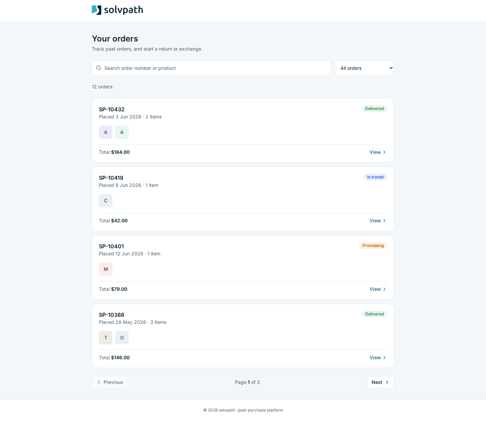
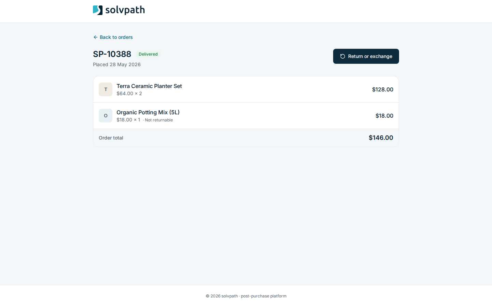
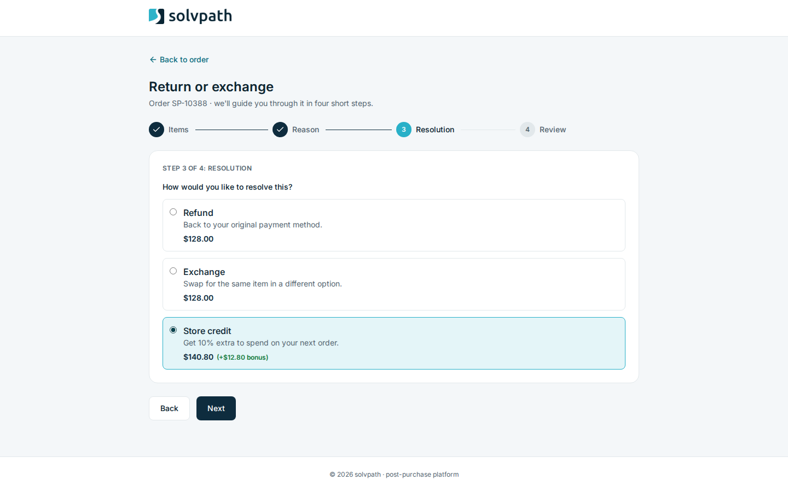
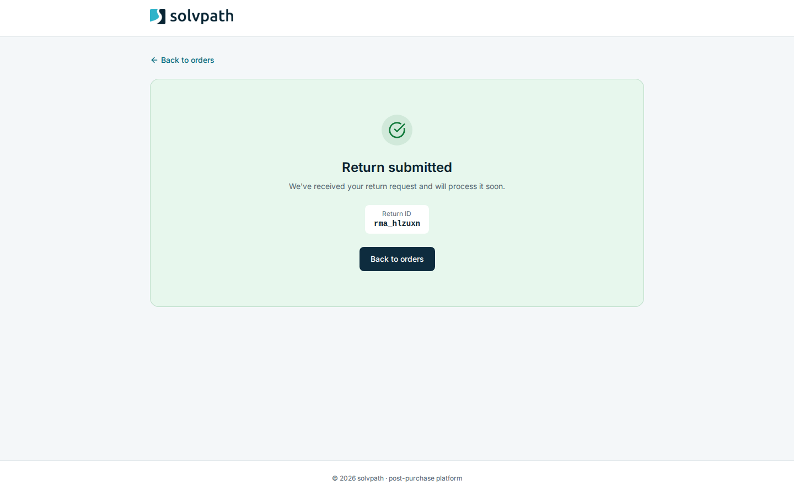
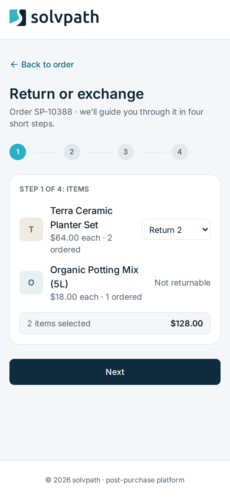
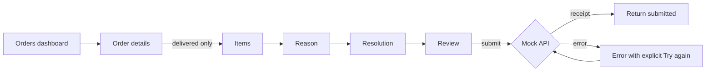
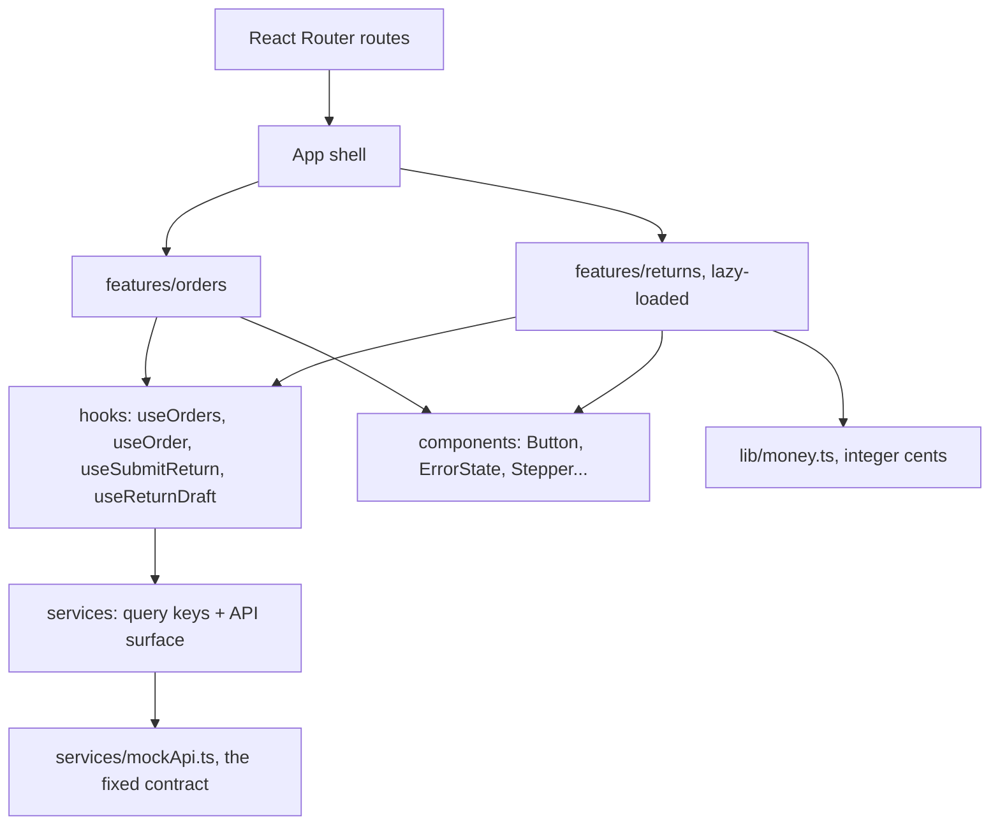

# Solvpath post-purchase experience

A React and TypeScript take-home project that models the customer journey after checkout: find an order, inspect its details, and complete a guided return or exchange. The app talks to an in-memory mock API that is deliberately slow and flaky, so loading, empty and failure states are part of the product rather than edge cases.



## Product walkthrough

The orders dashboard supports status filtering, debounced text search (order number or product name) and pagination. Delivered orders lead into a four-step return flow:

1. **Items**: choose which items to send back and how many of each. Quantities stop at what was ordered, and non-returnable lines are shown but cannot be selected.
2. **Reason**: pick a reason and optionally add a comment (up to 500 characters).
3. **Resolution**: refund to the original payment method, exchange, or store credit with a 10% bonus. Each option shows the exact amount.
4. **Review**: check everything, then submit.

Next stays disabled until the current step is complete and says what is missing. Back keeps every earlier answer.

| Order details | Resolution step |
| --- | --- |
|  |  |

| Submitted return | Item step on a phone |
| --- | --- |
|  |  |



## Run it

### With Docker (no local Node needed)

```bash
docker build -t solvpath-returns .
docker run --rm -p 4173:4173 solvpath-returns
```

The image build installs dependencies with `npm ci`, then runs the type check, lint, the test suite and the production build. The build fails if any of them fails. The container then serves the bundle at `http://localhost:4173`.

### With Node.js

Node 22 is pinned in `.nvmrc` (the `engines` field also accepts Node 24.15+ and 26).

```bash
nvm use        # or any Node 22 install
npm ci
npm run dev    # http://localhost:5173
```

| Command | What it does |
| --- | --- |
| `npm run dev` | Vite dev server with hot reload |
| `npm run typecheck` | `tsc -b` across app and config |
| `npm run lint` | oxlint (React, TypeScript and oxc rules) |
| `npm test` | Vitest suite in jsdom |
| `npm run build` | Type check and production bundle in `dist/` |
| `npm run preview` | Serve the production bundle |

No environment variables are needed; the mock API runs in the browser.

## Architecture



- `src/features/orders`: dashboard, filters, cards, pagination and order details.
- `src/features/returns`: the flow page and one component per step.
- `src/hooks`: TanStack Query hooks for server state and a reducer for the return draft.
- `src/services`: the only module that touches the mock API. Swapping in a real HTTP client would change this folder alone.
- `src/lib`: money maths, formatting, error messages and the shared `QueryClient`.
- `src/components`: shared loading, empty, error, form and status primitives.

## Decisions

**Money stays in integer cents.** Totals, returned value and resolution amounts never use floating-point dollars. Store credit applies its bonus once to the returned value and rounds half up to a whole cent, so $83.00 becomes $91.30.

**Reads retry; writes do not.** Queries retry transient failures up to three times with exponential backoff, but never retry an abort, a 404 or a 422. The return submission has retries turned off: if the response is lost, an automatic retry could create a second return. The shopper sees the error and chooses whether to try again.

**The step is explicit state.** The flow keeps a step index next to the draft rather than deriving the step from which fields are filled, so choosing one item does not skip ahead and going back loses nothing. After Next or Back, focus moves to the new step's heading.

**Pagination belongs to a filter combination.** The page number is stored with the filters it was chosen for. When a filter changes, the page resets to 1 during render, without an effect, so the app never requests page 3 of a new search.

**Navigation is links, actions are buttons.** "Return or exchange" and "Back to orders" are real links styled as buttons, never an anchor inside a `<button>`.

**Accessibility is built into the components.** Inputs have labels, errors use `role="alert"`, the stepper marks the current step with `aria-current`, focus rings are visible, a skip link leads to the main content, and reduced-motion preferences turn off animation.

**Brand.** Colours and type come from the solvpath brand tokens (`src/styles/brand-tokens.css`), mapped into the Tailwind theme so utilities such as `bg-brand` and `text-accent-deep` stay on palette.

## Tests

80 Vitest and Testing Library tests run in jsdom:

- **Return flow** (`ReturnFlowPage.test.tsx`): renders the real route table with the service module mocked. It covers step gating, Back keeping answers, quantity caps, store-credit amounts, mapping the draft to the request, a failed submit followed by an explicit retry, and the not-delivered and load-error guards.
- **Orders** (`OrdersPage.test.tsx`, `OrderDetailPage.test.tsx`): card details, the status filter resetting the page, the search debounce, pagination, the empty state with clear filters, and error recovery.
- **Service layer**: the mock API contract with latency and random failures switched off (paging, filtering, search, 404/422/503, aborts), the query-key hierarchy, the retry policy, and the hooks calling the service with abort signals.
- **Units**: money maths, date and error formatting, the draft reducer, and shared components.

There is no browser end-to-end suite; a Playwright run against `npm run preview` would be the next step.

## Limits

- Data and submissions are mocked in memory; nothing persists across reloads.
- Authentication is out of scope.
- Filters and search live in component state, not the URL.
- A return draft is lost if the page is reloaded mid-flow.

## License

MIT, see [LICENSE](LICENSE).
